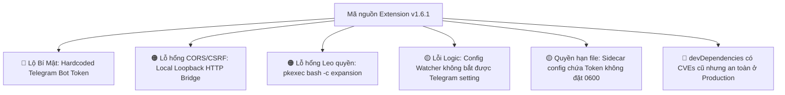

# AUDIT REPORT: Antigravity Auto-Plan Extension v1.6.1
**AUDIT SCOPE: FULL**
**Auditor:** Khang — Senior Security Engineer & System Auditor (Antigravity Code Doctor)  
**Date:** 2026-10-11 06:38:00 (ICT)  
**Status:** Completed  

---

## 🩺 TỔNG QUAN HỒ SƠ BỆNH ÁN (EXECUTIVE SUMMARY)

Dự án **Antigravity Auto-Plan Runner** (`antigravity-auto-plan` v1.6.1) là một extension dành cho **Antigravity IDE / VS Code**, đảm nhận chức năng điều phối tự động hóa nhiều giai đoạn (multi-phase execution), phát hiện tiến độ qua transcript streaming (`~/.gemini/antigravity-ide/brain/`), và cung cấp cầu nối điều khiển từ xa qua Telegram Bot (`grammY`).

Sau quá trình khám nghiệm chuyên sâu toàn bộ mã nguồn (17 source files TypeScript, ~5.500 dòng mã) cùng các thành phần native và cấu hình manifest:

| Chỉ số sức khỏe | Đánh giá lâm sàng |
| :--- | :--- |
| **Compiler & Static Analysis** | 🟢 **100% Sạch** — `tsc --noEmit` hoàn thành không có lỗi biên dịch. |
| **Unit & E2E Test Suite** | 🟢 **100% Pass** — Toàn bộ test suite E2E Phase 05 đều vượt qua thành công. |
| **Production Runtime Dependencies** | 🟢 **Sạch** — Chỉ có `grammy@1.46.0` trong production bundle, 0 CVE lỗ hổng. |
| **An toàn Bí mật (Secrets)** | 🔴 **Báo động Đỏ** — Token Telegram Bot production đang bị hardcode công khai trong source code và manifest. |
| **Cơ chế IPC / HTTP Bridge** | 🟠 **Nguy cơ Cao** — Server HTTP loopback mở `Access-Control-Allow-Origin: *` và thiếu token xác thực, cho phép các trang web trên trình duyệt điều khiển IDE. |
| **Quyền hạn Leo thang (Elevation)** | 🟠 **Nguy cơ Cao** — Lệnh `pkexec bash -c "..."` có lỗ hổng mở rộng biến shell (variable expansion) khi ghi file quyền root. |



---

## 📊 BẢNG TỔNG HỢP FINDINGS THEO PHÂN LOẠI & MỨC ĐỘ

| Mã bệnh | Vấn đề phát hiện | Phân loại | Severity | Confidence | Khả năng khai thác |
| :--- | :--- | :--- | :--- | :--- | :--- |
| **FINDING-01** | Lộ Token Telegram Bot Production trong Repo & Manifest | Security / Secrets | 🔴 **Critical** | **High** | Trivial (Rất dễ) |
| **FINDING-02** | HTTP Bridge loopback mở CORS `*` không xác thực | Security / IPC | 🟠 **High** | **High** | Moderate (Trung bình) |
| **FINDING-03** | Khai thác mở rộng biến Shell trong lệnh `pkexec bash -c` | Security / Elevation | 🟠 **High** | **High** | Complex (Phức tạp) |
| **FINDING-04** | Config Watcher không bắt được sự kiện thay đổi Telegram Settings | Correctness / Reliability | 🟡 **Medium** | **High** | N/A (Lỗi logic) |
| **FINDING-05** | Lưu trữ Token bản rõ trong file `autoplan-config.json` thiếu quyền `0600` | Security / Privacy | 🟡 **Medium** | **High** | Moderate (Trung bình) |
| **FINDING-06** | Thiếu đăng ký dọn dẹp `bridgeServer` trong `context.subscriptions` | Reliability / Lifecycle | 🔵 **Low** | **High** | N/A |
| **FINDING-07** | Lỗ hổng trong devDependencies (`mocha`, `@vscode/vsce`) | Dependency | 🔵 **Low** | **High** | Theoretical |

---

## 🔬 CHI TIẾT KẾT QUẢ KHÁM & PHÁC ĐỒ ĐIỀU TRỊ

---

### 🔴 FINDING-01: Lộ Token Telegram Bot Production trong Repository & Manifest

- **Severity:** Critical
- **Confidence:** High
- **Category:** Security / Secrets Management
- **Exploitability:** Trivial
- **Impact:** Token thật của Telegram Bot bị lưu cố định dưới dạng văn bản rõ trong code và schema cấu hình mặc định. Bất kỳ ai clone mã nguồn, đọc commit git, hoặc cài đặt gói extension `.vsix` đều có thể chiếm toàn quyền kiểm soát Telegram Bot (`@Antigravity_skul9x_bot`), chặn nghe thông báo tiến độ, kích hoạt chụp ảnh màn hình máy tính (`/screen`), hoặc gửi prompt điều khiển IDE từ xa.

#### 🔎 Triệu chứng & Bằng chứng thực tế
Chuỗi Token `8930752011:AAG6HyFKC********************` xuất hiện tại các vị trí:
1. [`package.json:285`](file:///home/skul9x/Desktop/Code/Auto-plan-Extension-main/package.json#L285):
   ```json
   "autoplan.telegramBotToken": {
     "type": "string",
     "default": "8930752011:AAG6HyFKC********************",
     "description": "Telegram Bot API Token (obtained from @BotFather)"
   }
   ```
2. [`src/config.ts:75-76`](file:///home/skul9x/Desktop/Code/Auto-plan-Extension-main/src/config.ts#L75-L76):
   ```typescript
   telegramEnabled: true,
   telegramBotToken: '8930752011:AAG6HyFKC********************',
   telegramAllowedUsers: [5083643114],
   ```
3. [`docs/BRIEF_TELEGRAM_REMOTE.md:12`](file:///home/skul9x/Desktop/Code/Auto-plan-Extension-main/docs/BRIEF_TELEGRAM_REMOTE.md#L12)
4. [`plans/261011-0330-telegram-remote-control/BRIEF.md:12`](file:///home/skul9x/Desktop/Code/Auto-plan-Extension-main/plans/261011-0330-telegram-remote-control/BRIEF.md#L12)
5. Được đóng gói trực tiếp vào file release [`antigravity-auto-plan-1.6.1.vsix`](file:///home/skul9x/Desktop/Code/Auto-plan-Extension-main/antigravity-auto-plan-1.6.1.vsix).

#### 💊 Phác đồ điều trị khẩn cấp
1. **Thu hồi ngay lập tức (Immediate Revoke):** Truy cập [@BotFather](https://t.me/BotFather) trên Telegram, sử dụng lệnh `/revoke` để hủy bỏ hoàn toàn token hiện tại và sinh token mới.
2. **Loại bỏ token mặc định:**
   - Đặt `default: ""` trong [`package.json`](file:///home/skul9x/Desktop/Code/Auto-plan-Extension-main/package.json).
   - Đặt `telegramBotToken: ""` và `telegramAllowedUsers: []` trong [`src/config.ts`](file:///home/skul9x/Desktop/Code/Auto-plan-Extension-main/src/config.ts).
3. **Sử dụng SecretStorage:** Khuyến nghị lưu trữ token qua VS Code API `context.secrets.store('autoplan.telegramToken', token)` thay vì lưu trong file cấu hình công khai.

---

### 🟠 FINDING-02: HTTP Bridge Loopback Mở CORS `*` Không Xác Thực (Cross-Origin IDE Hijacking)

- **Severity:** High
- **Confidence:** High
- **Category:** Security / Inter-Process Communication (IPC)
- **Exploitability:** Moderate
- **Impact:** Khi lập trình viên duyệt web trên trình duyệt (Chrome, Firefox, v.v.), bất kỳ trang web độc hại nào cũng có thể quét cổng loopback `48860-48900` hoặc `49200-49220`. Do máy chủ bật `Access-Control-Allow-Origin: *` và không yêu cầu Secret Token, trang web độc hại có thể gửi lệnh `POST /autoplan-command` để ép Antigravity AI thực thi mã độc trong terminal hoặc đọc thông tin workspace qua `GET /autoplan-status`.

#### 🔎 Triệu chứng & Bằng chứng thực tế
Trong file [`src/bridgeServer.ts:652-654`](file:///home/skul9x/Desktop/Code/Auto-plan-Extension-main/src/bridgeServer.ts#L652-L654):
```typescript
// 2. Standard CORS headers
res.setHeader('Access-Control-Allow-Origin', '*');
res.setHeader('Access-Control-Allow-Methods', 'GET, POST, OPTIONS');
res.setHeader('Access-Control-Allow-Headers', 'Content-Type, X-Window-Key');
```
Đồng thời, hàm `handlePostCommand` nhận và gửi lệnh thẳng vào AI prompt dispatcher mà không kiểm tra bất kỳ secret bearer token nào:
```typescript
private handlePostCommand(req: http.IncomingMessage, res: http.ServerResponse): void {
  this.readJsonBody<{ type?: string; text?: string; ... }>(req, (err, body) => {
    ...
    this.dispatchPromptCommand(body.text, ...);
  });
}
```

#### 💊 Phác đồ điều trị
1. **Bỏ Wildcard CORS:** Chỉ cho phép request không có header `Origin` (non-browser) hoặc Origin bắt đầu bằng `vscode-file://`, `vscode-webview://`.
2. **Session Secret Token:** Sinh một `bridgeSecretToken` ngẫu nhiên (32 bytes hex) khi `BridgeServer` khởi động, ghi token này vào memory/sidecar config cho DOM script, và bắt buộc mọi request HTTP gửi header `X-Bridge-Auth: <token>`.

```typescript
// Đề xuất sửa trong src/bridgeServer.ts:
const origin = req.headers['origin'];
if (origin && !origin.startsWith('vscode-file://') && !origin.startsWith('vscode-webview://')) {
  res.writeHead(403, { 'Content-Type': 'application/json' });
  res.end(JSON.stringify({ error: 'Untrusted origin rejected' }));
  return;
}
```

---

### 🟠 FINDING-03: Nguy cơ Shell Variable Expansion trong Lệnh Ghi Quyền Root (`pkexec`)

- **Severity:** High
- **Confidence:** High
- **Category:** Security / Command Injection
- **Exploitability:** Complex
- **Impact:** Trong môi trường Linux, khi extension cần cập nhật `workbench.html` thuộc sở hữu của root, hàm `buildLinuxElevationCommand` tạo lệnh bash qua `pkexec`. Đoạn lệnh được bọc trong dấu ngoặc kép `"..."`, khiến dấu nháy đơn `'...'` bên trong mất tác dụng bảo vệ khỏi sự mở rộng biến của Bash (`$()`, `` ` ``, `$VAR`), tạo nguy cơ thực thi mã ngoài dự kiến dưới quyền root nếu đường dẫn chứa ký tự đặc biệt.

#### 🔎 Triệu chứng & Bằng chứng thực tế
Trong [`src/workbenchInjector.ts:182-186`](file:///home/skul9x/Desktop/Code/Auto-plan-Extension-main/src/workbenchInjector.ts#L182-L186):
```typescript
export function buildLinuxElevationCommand(tmpPath: string, targetPath: string): string {
  const safeTmp = tmpPath.replace(/'/g, "'\\''");
  const safeTarget = targetPath.replace(/'/g, "'\\''");
  return `pkexec bash -c "cp '${safeTmp}' '${safeTarget}' && chmod 644 '${safeTarget}'"`;
}
```
Trong bash, chuỗi `"cp '$foo' '$bar'"` vẫn mở rộng `$foo` và `$bar` vì chúng nằm trong cặp ngoặc kép.

#### 💊 Phác đồ điều trị
Sử dụng tham số vị trí (positional parameters) để truyền biến an toàn tuyệt đối mà không cần nối chuỗi:
```typescript
export function buildLinuxElevationCommand(tmpPath: string, targetPath: string): string {
  const safeTmp = tmpPath.replace(/'/g, "'\\''");
  const safeTarget = targetPath.replace(/'/g, "'\\''");
  return `pkexec bash -c 'cp "$1" "$2" && chmod 644 "$2"' _ '${safeTmp}' '${safeTarget}'`;
}
```

---

### 🟡 FINDING-04: Config Watcher Không Bắt Được Sự Kiện Thay Đổi Telegram Settings

- **Severity:** Medium
- **Confidence:** High
- **Category:** Correctness / Reliability
- **Exploitability:** N/A (Lỗi chức năng)
- **Impact:** Khi người dùng thay đổi các thiết lập như `autoplan.telegramBotToken` hay `autoplan.telegramEnabled` trong Settings UI của VS Code, hàm lắng nghe không được kích hoạt, dẫn đến bot không bao giờ tải lại cấu hình nếu không khởi động lại toàn bộ IDE.

#### 🔎 Triệu chứng & Bằng chứng thực tế
Trong [`src/extension.ts:1644-1650`](file:///home/skul9x/Desktop/Code/Auto-plan-Extension-main/src/extension.ts#L1644-L1650):
```typescript
const configWatcher = vscode.workspace.onDidChangeConfiguration((e) => {
  if (e.affectsConfiguration('autoplan')) {
    triggerDebouncedConfigUpdate(context);
    if (e.affectsConfiguration('autoplan.telegram')) {
      telegramBridge.reloadConfig();
    }
  }
});
```
Nhưng trong [`package.json:270-308`](file:///home/skul9x/Desktop/Code/Auto-plan-Extension-main/package.json#L270-L308), các khóa cấu hình được đặt phẳng:
- `autoplan.telegramEnabled`
- `autoplan.telegramBotToken`
- `autoplan.telegramAllowedUsers`
- `autoplan.telegramThrottleMs`
API `affectsConfiguration('autoplan.telegram')` của VS Code chỉ nhận diện các khóa có tiền tố `autoplan.telegram.` (có dấu chấm phân cách section). Do đó, câu lệnh `telegramBridge.reloadConfig()` vĩnh viễn không bao giờ được gọi.

#### 💊 Phác đồ điều trị
Cập nhật điều kiện kiểm tra trong [`src/extension.ts`](file:///home/skul9x/Desktop/Code/Auto-plan-Extension-main/src/extension.ts):
```typescript
if (
  e.affectsConfiguration('autoplan.telegramEnabled') ||
  e.affectsConfiguration('autoplan.telegramBotToken') ||
  e.affectsConfiguration('autoplan.telegramAllowedUsers') ||
  e.affectsConfiguration('autoplan.telegramThrottleMs')
) {
  telegramBridge.reloadConfig();
}
```

---

### 🟡 FINDING-05: Lưu Trữ Token Bản Rõ Trong File Cấu Hình Sidecar Không Đặt Quyền `0600`

- **Severity:** Medium
- **Confidence:** High
- **Category:** Security / Privacy / Configuration
- **Exploitability:** Moderate (Trên hệ điều hành đa người dùng)
- **Impact:** Hàm `writeSidecarConfig` xuất toàn bộ đối tượng cấu hình `currentConfig` (bao gồm cả `telegramBotToken`) vào file `autoplan-config.json` bằng `fs.writeFileSync` mà không chỉ định quyền bảo vệ `mode: 0o600`. File này được ghi ra với quyền mặc định của hệ thống (`0644` hoặc `0664`), cho phép bất kỳ user cục bộ nào khác trên cùng máy chủ đọc được token.

#### 🔎 Triệu chứng & Bằng chứng thực tế
Trong [`src/config.ts:210-255`](file:///home/skul9x/Desktop/Code/Auto-plan-Extension-main/src/config.ts#L210-L255):
```typescript
const currentConfig = {
  ...baseConfig, // Bao gồm telegramBotToken
  executionMode,
  allowTierFallback,
  strictMode
};
const content = JSON.stringify(currentConfig, null, 2);
...
fs.writeFileSync(configPath, content, 'utf8');
```
DOM Bridge script (`autoplan-dom-bridge.js`) chạy trong ngữ cảnh renderer và hoàn toàn không cần đến `telegramBotToken`.

#### 💊 Phác đồ điều trị
1. Loại bỏ các trường nhạy cảm trước khi serialize vào `autoplan-config.json`:
   ```typescript
   const { telegramBotToken, ...sanitizedConfig } = currentConfig;
   const content = JSON.stringify(sanitizedConfig, null, 2);
   ```
2. Thêm cờ `{ mode: 0o600 }` vào lời gọi `fs.writeFileSync`.

---

### 🔵 FINDING-06: Thiếu Đăng Ký Dọn Dẹp `bridgeServer` Vào `context.subscriptions`

- **Severity:** Low
- **Confidence:** High
- **Category:** Reliability / Resource Lifecycle
- **Exploitability:** N/A
- **Impact:** `bridgeServer` chỉ được dừng trong hàm `deactivate()`. Nếu quá trình khởi động `activate()` bị lỗi nửa chừng, `bridgeServer` không được VS Code tự động dọn dẹp theo chu trình vòng đời chuẩn của extension.

#### 🔎 Triệu chứng & Bằng chứng thực tế
Trong [`src/extension.ts:1660-1684`](file:///home/skul9x/Desktop/Code/Auto-plan-Extension-main/src/extension.ts#L1660-L1684), danh sách `context.subscriptions.push(...)` có chứa `transcriptWatcher`, `orchestrator`, `telegramSubscription` nhưng bỏ sót `bridgeServer`.

#### 💊 Phác đồ điều trị
Thêm subscription bọc vào `context.subscriptions`:
```typescript
context.subscriptions.push({
  dispose: () => {
    bridgeServer.stop().catch(() => {});
  }
});
```

---

### 🔵 FINDING-07: Thư Viện devDependencies Chứa Lỗ Hổng Bị Cảnh Báo Bởi Scanner Native

- **Severity:** Low
- **Confidence:** High
- **Category:** Dependency
- **Exploitability:** Theoretical
- **Impact:** Lệnh `npm audit` ghi nhận 10 cảnh báo lỗ hổng (trong các gói `brace-expansion`, `diff`, `linkify-it`, `qs`, `serialize-javascript`, `source-map-js`, `undici`). Tuy nhiên, kiểm tra chuyên sâu bằng `npm ls --omit=dev` xác nhận rằng 100% các lỗ hổng này đều nằm trong công cụ phát triển `devDependencies` (`mocha` và `@vscode/vsce`). Chúng không được đóng gói vào runtime thực tế của extension (`grammy@1.46.0` sạch hoàn toàn). Do đó, nguy cơ đối với người dùng cuối ở production là xấp xỉ 0.

#### 💊 Phác đồ điều trị
Nâng cấp devDependencies lên phiên bản mới nhất:
- `@vscode/vsce`: nâng lên phiên bản `^3.x`
- `mocha`: cập nhật phiên bản vá lỗi tương thích

---

## 📋 KẾ HOẠCH HÀNH ĐỘNG KHUYẾN NGHỊ (PRESCRIPTION)

1. **Bước 1 (Khẩn cấp):** Thu hồi và sinh mới Telegram Bot Token trên `@BotFather`.
2. **Bước 2:** Xóa sạch token hardcode trong [`package.json`](file:///home/skul9x/Desktop/Code/Auto-plan-Extension-main/package.json) và [`src/config.ts`](file:///home/skul9x/Desktop/Code/Auto-plan-Extension-main/src/config.ts).
3. **Bước 3:** Thêm xác thực Secret Token và siết chặt CORS cho [`src/bridgeServer.ts`](file:///home/skul9x/Desktop/Code/Auto-plan-Extension-main/src/bridgeServer.ts).
4. **Bước 4:** Sửa lỗi Bash expansion trong [`src/workbenchInjector.ts`](file:///home/skul9x/Desktop/Code/Auto-plan-Extension-main/src/workbenchInjector.ts).
5. **Bước 5:** Điều chỉnh bộ lọc sự kiện config trong [`src/extension.ts`](file:///home/skul9x/Desktop/Code/Auto-plan-Extension-main/src/extension.ts) để hỗ trợ hot-reload Telegram settings.
6. **Bước 6:** Chạy lại `npm test` và đóng gói lại bản phát hành VSIX mới.
