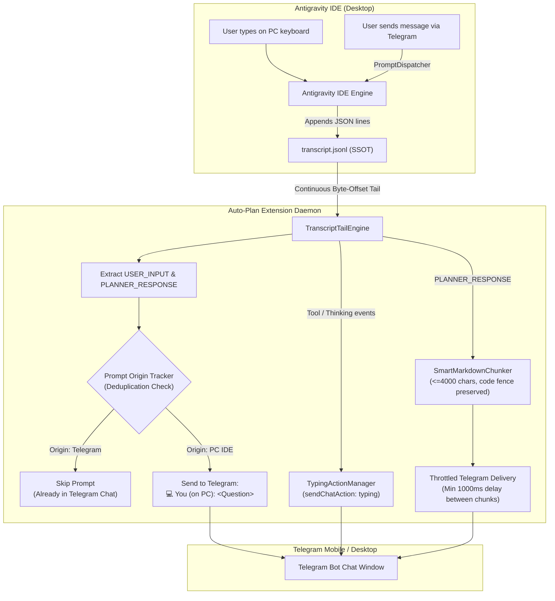

# Plan: Telegram Clean Q&A Sync (Two-Way Live Question & Answer Mirror)

Created: 2026-10-11 20:25
Status: 🟢 Completed
Target Version: v1.6.4

## Overview
Implement **Clean Q&A Sync** for the Antigravity Auto-Plan Extension. This feature enables seamless, two-way synchronization of user prompts and AI responses between the Antigravity IDE desktop environment and the Telegram Bot chat window without interacting with the browser DOM. Whether prompts are typed directly into the IDE or sent via Telegram, both questions and answers are synchronized cleanly into Telegram with zero duplication, active typing indicators, and robust markdown code block chunking under Telegram's 4096-character limit.



## Key Architectural Principles & Best Practices
1. **Single Source of Truth (SSOT)**:
   - Reads directly from `~/.gemini/antigravity-ide/brain/<conv-id>/.system_generated/logs/transcript.jsonl`.
   - Never attaches to Electron DOM or opens browser tabs.
2. **Persistent Byte-Offset Tailing (`readline` + `fs.createReadStream`)**:
   - Tracks file position with `readOffset` to read only appended bytes.
   - Low memory footprint (O(1) RAM usage regardless of transcript file size).
3. **Prompt Deduplication & Origin Tracking**:
   - Maintains an in-memory normalized hash ring buffer (`PromptOriginTracker`) with a 60-second TTL.
   - Suppresses mirroring of user questions that originated from Telegram to avoid duplicate messages.
   - Mirror questions typed directly on the PC keyboard with a distinct header: `💻 You (on PC): ...`.
4. **Typing Indicators (`sendChatAction: typing`)**:
   - Sends Telegram typing action every 4 seconds during active agent thinking/tool execution.
   - Clears typing status immediately when final AI response begins delivering.
5. **Smart Markdown Code Block Chunking (Telegram 4096-char Limit)**:
   - Safely splits long AI responses into <= 4000-character chunks along line and paragraph boundaries.
   - Accurately tracks open/close triple backticks (```) and re-opens fences across chunk boundaries to prevent Telegram formatting corruption or `400 Bad Request: can't parse entities` errors.
   - Enforces a minimum 1000ms interval between sequential chunk deliveries to adhere strictly to Telegram rate limits.

## Tech Stack
- Runtime: Node.js 20+ / VS Code Extension Host (TypeScript 5.3)
- Bot Framework: `grammY` (v1.21.0+)
- Stream Engine: Node.js built-in `fs`, `readline`, `crypto`, `events`
- Text Processing: Clean Plain Text & Smart Markdown Entity-Aware Chunking

## Phases

| Phase | Name | Status | Test |
|-------|------|--------|------|
| 01 | Continuous Transcript Tail Engine & Event Emitter | 🟢 Completed | `src/test/phase01_clean_qa_transcript_tail_engine.test.ts` |
| 02 | Deduplication Ring Buffer & Prompt Origin Tracker | 🟢 Completed | `src/test/phase02_clean_qa_dedup_origin_tracker.test.ts` |
| 03 | Typing Action & Smart Assistant Response Chunker | 🟢 Completed | `src/test/phase03_clean_qa_typing_and_smart_chunker.test.ts` |
| 04 | Full End-to-End Chat Mirror Integration & Configuration | 🟢 Completed | `src/test/phase04_clean_qa_e2e_mirror_integration.test.ts` |
| 05 | Regression Verification, Documentation & Release Packaging | 🟢 Completed | `src/test/phase05_clean_qa_release_packaging.test.ts` |

## Quick Commands
- Start Phase 1: Implement `phase-01-transcript-tail-engine.md`
- Run Phase 1 Test: `node out/test/phase01_clean_qa_transcript_tail_engine.test.js`
- Compile: `npm run compile`
- Package: `npm run compile && vsce package`
