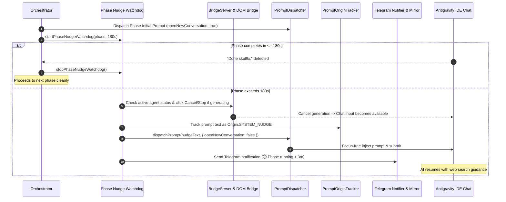

# Plan: Long-Running Phase Nudge Watchdog & Mid-Flight Steering

Created: 2026-10-11 22:00
Status: ✅ Completed
Target Version: v1.6.5

## Overview
When an orchestrated plan phase executes for longer than 3 minutes (180 seconds), the AI Agent in Antigravity IDE may become stuck in a speculative loop, lose track of guidelines, or attempt to build complex solutions without consulting up-to-date documentation.

This feature implements a proactive **Long-Running Phase Nudge Watchdog**:
1. Monitors the elapsed runtime of each active phase during execution.
2. If runtime exceeds 180 seconds (configurable via `autoplan.longPhaseThresholdSeconds`), triggers a one-shot mid-flight steering intervention.
3. Automatically pauses/cancels active agent generation via DOM Bridge Cancel button (`findCancelButton`) or VS Code chat stop command if the AI is actively busy.
4. Waits for the chat interface to stabilize and the send button to become enabled.
5. Injects the exact required steering prompt into the existing conversation (`openNewConversation: false`):
   ```text
    Search online to find the best practices. Note, do not open a browser and directly access the DOM. Use search_web / read_url_content when you need to look something up. 
   ```
6. Dispatches the prompt focus-free via Tier 1 DOM Bridge (or fallbacks).
7. Records the prompt in `PromptOriginTracker` with origin `SYSTEM_NUDGE` to prevent duplicate mirroring and distinguish it from manual user prompts.
8. Sends a proactive alert to Telegram Bot: `⏱️ [Auto-Plan Nudge] Phase X running > 3m: Dispatched best-practice steering prompt into IDE chat.`



## Key Architectural Principles & Best Practices
1. **One-Shot Guarantee Per Phase**:
   - Executes at most once per phase (`phase.hasNudged = true`).
   - Prevents repetitive chat interruptions if a phase legitimately takes longer (e.g., long compilation/bundle steps).
2. **Safe Cooperative Interruption**:
   - If AI is generating, gracefully triggers the DOM Cancel button (`findCancelButton`) or VS Code chat stop command.
   - Waits up to 3000ms for input stabilization before dispatching the prompt.
3. **In-Session Steering (`openNewConversation: false`)**:
   - Keeps the existing chat history and context intact.
   - Avoids spinning up redundant chat tabs.
4. **Origin Separation & Mirror Harmony**:
   - Registers prompt in `PromptOriginTracker` with `Origin.SYSTEM_NUDGE`.
   - Telegram Chat Mirror clearly displays `🤖 [Auto-Plan Nudge]: ...` without echoing as a user-typed question.
5. **Robust Non-Fatal Fallback**:
   - If prompt dispatch or cancellation encounters an error, the watchdog logs a diagnostic warning and lets the phase continue running without crashing the orchestrator loop.

## Tech Stack
- Runtime: Node.js 20+ / VS Code Extension Host (TypeScript 5.3)
- Bridge IPC: Node.js HTTP Server (`BridgeServer`) & Electron Renderer DOM Bridge (`autoplan-dom-bridge.js`)
- Bot Framework: `grammY` (v1.21.0+)
- Testing: Comprehensive standalone test runners (`tsx` / Node.js test harness)

## Phases

| Phase | Name | Status | Test |
|-------|------|--------|------|
| 01 | Configuration Schema & DOM Bridge Stop Command Subsystem | ✅ Completed | `src/test/phase01_nudge_config_and_bridge_stop.test.ts` |
| 02 | Orchestrator Long-Phase Nudge Watchdog Engine | ✅ Completed | `src/test/phase02_orchestrator_nudge_watchdog.test.ts` |
| 03 | Mid-Flight Prompt Injection & Origin Tracking Integration | ✅ Completed | `src/test/phase03_prompt_injection_and_origin_tracking.test.ts` |
| 04 | Telegram Nudge Notification & Dashboard State Integration | ✅ Completed | `src/test/phase04_telegram_nudge_notification_e2e.test.ts` |
| 05 | Regression Verification, Documentation & Release Packaging (v1.6.5) | ✅ Completed | `src/test/phase05_nudge_watchdog_release_packaging.test.ts` |
