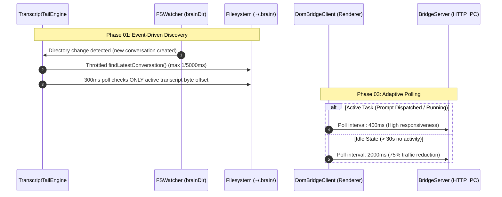

# Plan: Performance, Resource & Event Loop Remediation (v1.6.6)

Created: 2026-10-12 06:15
Status: ✅ Completed
Target Version: v1.6.6

## Overview
During the v1.6.5 clinical performance and system resource audit (`docs/reports/audit_20261012_0610_performance.md`), 4 actionable performance bottlenecks were identified across the streaming pipeline, Telegram legacy fallback, DOM bridge polling, and string extraction routines:

1. **PERF-01 (TranscriptTailEngine Disk I/O Storm)**: `pollTick()` executes every 300ms and invokes `findLatestConversation()`, issuing `fs.readdir` and sequential `stat` calls across all historical conversations in `.brain/` (160–330 I/O operations/sec).
2. **PERF-02 (Synchronous Event Loop Blocking in Telegram Fallback)**: `awaitAndReplyModelResponse` executes `findLatestConversation` synchronously inside a 250ms polling loop, blocking the Node.js Extension Host main thread when chat mirroring is disabled.
3. **PERF-03 (Idle Loopback HTTP Polling Overhead)**: Injected `DomBridgeClient` in `workbench.html` polls `/autoplan-status` at a fixed 500ms interval indefinitely, even when the IDE is completely idle for hours.
4. **PERF-04 (String Allocation Churn in Prompt Extraction)**: `extractUserPrompt` runs multiple sequential global regex replacements across entire raw content buffers, creating redundant intermediate string copies during large turns.

This plan resolves 100% of these findings through event-driven file discovery, throttled fallback intervals, adaptive client backoff, and fast-path string processing.

---

## Architectural Principles & Standards
1. **Event-Driven Over Polling**: Rely primarily on native filesystem watchers (`fs.watch`) for directory changes, using polling solely as a throttled safety net.
2. **Non-Blocking Extension Host**: Never invoke synchronous filesystem APIs (`*Sync`) inside periodic loops or timers.
3. **Adaptive Backoff with Instant Wakeup**: Scale polling intervals dynamically based on user and executor activity, restoring immediate responsiveness on new actions.
4. **Zero-Allocation Fast Paths**: Bypass heavy regex replacements for plain text inputs lacking XML or metadata delimiters.
5. **Strict Test Isolation**: Exactly one comprehensive file-based test suite per phase verifying all core requirements.

---

## Phase Breakdown

- **Phase 01**: `phase-01-tail-engine-event-discovery-and-fast-prompt.md`
  - Remediates: PERF-01 and PERF-04.
  - Event-driven conversation transition, throttled 5000ms discovery fallback, top-N candidate stat pruning, and fast-path substring prompt extraction.
  - Test: `src/test/phase01_tail_engine_perf_throttle.test.ts`

- **Phase 02**: `phase-02-telegram-async-legacy-fallback.md`
  - Remediates: PERF-02.
  - Asynchronous non-blocking path resolution, throttled directory retry (1500ms), and stream lifecycle protection in `telegramBridge.awaitAndReplyModelResponse`.
  - Test: `src/test/phase02_telegram_async_legacy_fallback.test.ts`

- **Phase 03**: `phase-03-adaptive-dom-bridge-polling.md`
  - Remediates: PERF-03.
  - Dual-tier adaptive polling (Active 400ms / Idle 2000ms) with activity tracker and instant wakeup in `media/autoplan-dom-bridge.js`.
  - Test: `src/test/phase03_adaptive_dom_bridge_polling.test.ts`

- **Phase 04**: `phase-04-regression-benchmark-and-release-v1.6.6.md`
  - End-to-end regression verification, I/O benchmark validation, manifest version bump to `v1.6.6`, documentation updates, and production VSIX packaging.
  - Test: `src/test/phase04_performance_remediation_release.test.ts`
