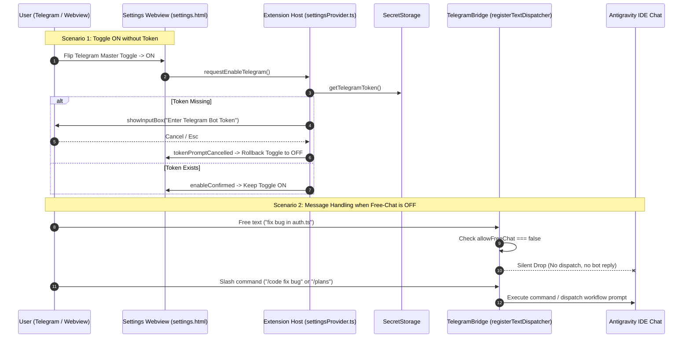

# Plan: Telegram Chat Control & Settings UI Modernization (v1.6.7)

Created: 2026-10-14 05:55
Status: ✅ Completed
Completed At: 2026-10-14 06:49:00+07:00
Target Version: v1.6.7

## Overview
This plan implements fine-grained Telegram chat gating and modernizes the extension's Settings Webview dashboard into a rich, tabbed control center with instant search filtering, optimistic auto-saving, and secure token lifecycle handling.

### Key Objectives
1. **Free-Text Chat Gating (Silent Drop)**:
   - Provide an independent toggle `autoplan.telegram.allowFreeChat` (default: `true`).
   - When disabled, arbitrary text messages from Telegram that are not slash commands are silently dropped (no reply, no prompt dispatched into Antigravity IDE).
   - All management slash commands (`/plans`, `/plan_status`, `/screen`, `/new_chat`, etc.) and AWF workflow commands (`/code`, `/brainstorm`, `/recap`, etc.) remain fully functional.
2. **Secure Token Integration & Automatic Rollback**:
   - Webview never displays raw bot tokens, reading solely cryptographic presence status from `SecretStorage`.
   - When the user toggles Telegram ON without a stored token, automatically invoke the VS Code `InputBox` modal to set the token.
   - If the user cancels (`Esc` / Cancel), execute an immediate optimistic rollback flipping the toggle back to `OFF`.
3. **Settings Dashboard Modernization (Tab Navigation & Search)**:
   - Restructure the cluttered, infinite-scrolling settings page into 4 intuitive categories:
     - 🔀 **Dispatch & Tiers**: Dispatch mode (Smart Cascade / Tier 1/2/3), fallback policy, transport diagnostics, 1-click bridge injection.
     - 🤖 **Telegram & Remote**: Master bot switch, free-text chat toggle, live Q&A mirroring, token management, whitelist, throttling.
     - ⏱️ **Timing & Automation**: Delay, timeouts, repeat count, phase nudge watchdog, default plan folder, prompt template & keywords.
     - 🩺 **Diagnostics & Logs**: Real-time phase audit report, DOM bridge live log viewer, log export, buffer clearing.
   - Add instant search filtering to find any setting across tabs in milliseconds.
   - Implement debounced auto-save (300ms) with optimistic UI updates and VS Code theme compliance.

---

## Architectural Principles & Standards
1. **Single Source of Truth (SSOT)**: All settings sync directly with `vscode.workspace.getConfiguration('autoplan')` at `ConfigurationTarget.Global`.
2. **Zero Plaintext Secrets in DOM**: Bot tokens are exclusively managed via `vscode.SecretStorage`. The webview only receives boolean presence (`hasToken`).
3. **Silent Drop by Design**: When free-chat is disabled, unprompted text incurs zero bot replies and zero IDE event-loop disruptions.
4. **Optimistic UI with Rollback**: Instant toggle animation with graceful reversion if backend validation or user input fails.
5. **Strict Test Isolation**: Exactly one comprehensive file-based test per phase verifying core functionality.

---

## Phase Breakdown

- **Phase 01**: `phase-01-core-config-and-telegram-silent-drop.md`
  - Adds `autoplan.telegram.allowFreeChat` configuration and implements silent drop gating in `telegramBridge.ts` for non-slash messages while preserving all workflow and management slash commands.
  - Test: `src/test/phase01_telegram_free_chat_gating.test.ts`

- **Phase 02**: `phase-02-token-secret-storage-and-rollback-ipc.md`
  - Implements backend IPC in `settingsProvider.ts` for secure token status reporting, token prompt modal invocation, and cancel rollback signalling.
  - Test: `src/test/phase02_settings_telegram_token_ipc.test.ts`

- **Phase 03**: `phase-03-modern-tab-navigation-and-search-ui.md`
  - Refactors `settings.html`, `settings.css`, and `settings.js` to implement 4 category tabs, real-time search filtering, and debounced auto-saving.
  - Test: `src/test/phase03_settings_tab_navigation_ui.test.ts`

- **Phase 04**: `phase-04-telegram-settings-card-and-rollback-e2e.md`
  - Builds the Telegram Remote Control card in the webview, binding the Master Switch, Free-Chat Toggle, Mirroring Toggle, Token Status Badges, and optimistic rollback.
  - Test: `src/test/phase04_telegram_settings_card_e2e.test.ts`

- **Phase 05**: `phase-05-regression-benchmark-and-release-v1.6.7.md`
  - End-to-end regression across all subsystems, documentation update (README, CHANGELOG, .brain), and packaging of `antigravity-auto-plan-1.6.7.vsix`.
  - Test: `src/test/phase05_telegram_chat_toggle_release.test.ts`
